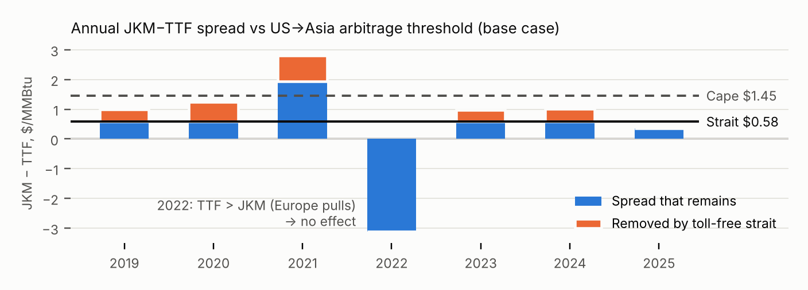

# MEMO — If Central America Were Islands: Impact on US LNG to Asia and the JKM–TTF Spread

**Date:** 18 November 2026  **Re:** Quantitative test of the "no Panama constraint" thesis  **Model:** `analysis/lng_model.py`

## Bottom line

The thesis is **right on direction, but sizes differ a lot by claim**: a large freight saving, partial price pass-through, little volume change.

| Thesis claim | Verdict | Size (base case) |
|---|---|---|
| US LNG reaches Asia cheaper and faster | **Holds** | −$0.87/MMBtu and −16 days one-way vs today's Cape route |
| JKM falls / TTF rises | **Holds, but small** | JKM −$0.13 (−1%), TTF +$0.27 (+2%) on average; up to −$0.28 / +$0.59 |
| JKM–TTF spread narrows | **Holds — the clearest effect** | Ceiling on the Asian premium falls from $1.45 to $0.58; average compression $0.40 |
| Total US export volume rises | **Does not hold (short run)** | ~0: plants already run at ~98% of capacity |
| US volume mix shifts toward Asia | **Holds, but small** | +0.6 to 1.3 Mt/yr (0.5–1.2% of US exports) |

Also: ~33 carriers (4% of fleet) freed, freight bill −$1.3bn/yr, US LNG delivered to Japan ~10% cheaper.

**Assumption:** the drift opens a sea gap along the canal's path. Distance stays the same as the Panama route (9,214 nm Sabine Pass–Tokyo [1]), with no tolls, queues, locks, draft limits or slot caps.

## Step 1 — Freight: what does the strait save?

Basis: modern 174k m³ two-stroke carrier, 17 knots (Platts basis [8]), mid-cycle charter rate.

- Cargo: 174,000 m³ × 98.5% fill × 0.45 t/m³ × 52 MMBtu/t = 4.01m MMBtu loaded → **3.9m delivered** (after boil-off and heel)
- Charter: **$75,000/day** (Flex LNG 2024–25 ~$72–75k; 5–10-yr charters high-$70ks [7])
- Fuel: 0.08%/day × 4.01m MMBtu × $10 = **$32,100/day** (boil-off 0.08–0.085%/day [8])
- All-in: $107,100/day ÷ 3.9m MMBtu = **2.75¢/MMBtu per voyage day**
- Round-trip days = 2 × one-way nm ÷ **408 nm/day** (17 kn × 24 h) + 2 port days
- Freight = (days × $107,100 + $0.2m port costs + tolls) ÷ 3.9m MMBtu

| Route from US Gulf (round trip) | One-way nm | Days | Calculation | $/MMBtu |
|---|---|---|---|---|
| Asia via Cape of Good Hope (today: 94% of US→Asia cargoes [3]) | 15,689 | 78.9 | (78.9 × 107.1k + 0.2m) ÷ 3.9m | **2.22** |
| Asia via Panama (toll $1.21m + 4 days transit/queue [5]) | 9,214 | 51.2 | (51.2 × 107.1k + 1.41m) ÷ 3.9m | **1.77** |
| Asia via new strait | 9,214 | 47.2 | (47.2 × 107.1k + 0.2m) ÷ 3.9m | **1.35** |
| NW Europe | 4,900 | 26.0 | (26.0 × 107.1k + 0.2m) ÷ 3.9m | **0.77** |

- Panama toll: laden $300k + $2.05 × 174k m³ = $656.7k; ballast at 85% = $558.2k; total = $1.21m (**$0.31/MMBtu**) [5]
- Saving vs Cape: 2.22 − 1.35 = **$0.87/MMBtu** (= 31.7 days × 2.75¢)
- One-way voyage time: 38.5 → 22.6 days (**−16 days**; Kpler has 38 vs 22 [2])
- Saving vs a working Panama: 1.77 − 1.35 = $0.42 (toll $0.31 + 4 days × 2.75¢ = $0.11)
- Why the Cape dominates today: Panama only beats the Cape if the queue is under ~18 days. In 2026, LNG queues ran 11–18 days and Panama had ~1–2 LNG slots/day [6], so ~93% of US→Asia cargoes still rounded the Cape [4].
- **Cross-check:** Platts' Cape-minus-Panama gap was mostly $0.95–1.29 in 2024–26 (near zero only at Sep-2025's trough rates) [9]; plus the toll, that implies a $1.3–1.6 saving. Platts uses older TFDE ships and values boil-off at delivered prices, so our $0.87 is **conservative**.

## Step 2 — Arbitrage threshold

A US cargo goes to Asia if JKM − F_Asia > TTF − F_Europe, i.e. **JKM − TTF > F_Asia − F_Europe**. Over 90% of new US volumes are sold FOB with free destination [14], so cargoes follow this rule.

- Old threshold (Cape): 2.22 − 0.77 = **$1.45/MMBtu**
- New threshold (strait): 1.35 − 0.77 = **$0.58/MMBtu**
- The threshold falls by the full **$0.87** (the Europe leg is unchanged)

The threshold is a **ceiling** on the Asian premium, not a floor. If JKM − TTF tries to rise above it, US cargoes flow east until it stops. When Europe is the tighter market (TTF > JKM), the strait is irrelevant.

## Step 3 — Does the lower ceiling bind? Replay of 2019–25

Each year's spread is tested against today's Cape-based threshold. Compression = min(max(spread − 0.58, 0), 0.87). Prices are $/MMBtu [10].

| | 2019 | 2020 | 2021 | 2022 | 2023 | 2024 | 2025 | Avg |
|---|---|---|---|---|---|---|---|---|
| JKM | 5.49 | 4.39 | 18.60 | 33.98 | 13.78 | 11.91 | 12.26 | |
| TTF | 4.50 | 3.15 | 15.80 | 37.10 | 12.80 | 10.90 | 11.90 | |
| JKM − TTF | +0.99 | +1.24 | +2.80 | −3.12 | +0.98 | +1.01 | +0.36 | +0.61 |
| **Compression** | 0.41 | 0.66 | 0.87 (cap) | 0 | 0.40 | 0.43 | 0 | **0.40** |

- **Binds in 5 of 7 years**; not in 2022 (TTF > JKM) or 2025 (spread already below $0.58).
- **Sensitivity** (charter $25k / $75k / $150k per day): freight saving $0.46 / $0.87 / $1.48; average compression $0.34 / $0.40 / $0.25; binds 6 / 5 / 4 of 7 years. The result is robust at ~$0.25–0.40: cheap freight means a smaller saving that binds more often.
- **2026 live test (Qatar/Hormuz outage):** In April the Platts arbitrage was open via Panama (+$0.53) but closed via the Cape (−$0.68); in July, +$0.21 vs −$1.08 [9]. Panama took only 6–11 laden LNG transits a month [4]. A free strait would have opened the arbitrage for every US cargo, which is exactly when the ceiling bites.

## Step 4 — Who absorbs the compression?

Global LNG supply is fixed (plants run flat-out). Assume demand is equally price-responsive per tonne in both basins. Then the volume-weighted price is unchanged: 271 Mt × ΔJKM + 126 Mt × ΔTTF = 0 [12].

- Asia share of imports = 271 ÷ 397 = **68%**
- ΔTTF = +0.68 × C and ΔJKM = −0.32 × C, where C is the compression
- Average year (C = 0.40): **TTF +$0.27 (+2%), JKM −$0.13 (−1%)**
- Tight-Asia year (C = 0.87): **TTF +$0.59, JKM −$0.28**
- The larger LNG market (Asia) moves less. If Europe's pipeline and storage flexibility make it deeper, the split moves toward 50/50: **the total is robust; the split is an assumption.**
- Other spreads: Henry Hub is unchanged in the short run (feedgas is capped by plant capacity). TTF–HH and the US FOB netback rise **+$0.27**; JKM–HH falls $0.13. Pacific-coast North American LNG (LNG Canada, Costa Azul) loses ~$0.87 of its freight edge into Asia.

## Step 5 — Volumes and mix

- **Total US exports:** 2025 exports were 15.1 Bcf/d against ~15.4 Bcf/d of capacity = **98% utilization** [11]. So there is no short-run volume gain; utilization only fell in 2020's price collapse.
- **Demand response:** ~7 Mt of LNG demand per $1/MMBtu. OIES finds $6 gas adds ~60 bcm (~44 Mt) [13]; the 2026 shock implies 5–11 Mt per $1.
- By region: Asia 7 × 68% = 4.8 Mt/$; Europe 7 × 32% = 2.2 Mt/$
- Mt moved Europe→Asia per $1 of compression = 4.8 × 2.2 ÷ 7.0 = **1.52 Mt**
- Average year: 1.52 × 0.40 = **0.6 Mt (~8 cargoes)**; tight-Asia year: 1.52 × 0.87 = **1.3 Mt (~17 cargoes)**. That is 0.5–1.2% of 2025 US exports (111 Mt), or 1.8–4.0 Mt with a 3× larger long-run response.
- Sanity check: Asia's share of US exports fell from ~46% (2017–21, Panama era) to 26% / 33% / 16% (2023–25) [11]. That drop is mostly Europe replacing Russian pipeline gas, not routing.
- **Shipping:** 31.6 Mt to Asia (2024) [16] × 94% via Cape ÷ 0.0771 Mt per cargo = 385 cargoes/yr. 385 × 31.7 days saved = 12,200 ship-days = **33 ships (4% of the 804-ship fleet [12])** and **−$1.3bn/yr** of freight, which weakens charter rates.
- **Long run:** US delivered cost to Japan = 1.15 × $3.52 Henry Hub + $2.80 fee + freight = $9.07 via Cape → **$8.19 via strait (−10%)**. That improves the case for Asian buyers signing US supply contracts, which is where a larger mix shift would come from (not quantified).

## Conclusion

**The thesis is correct on direction, but it overstates the price and volume effects.**

- The strait cuts ~$0.87/MMBtu and 16 days from US→Asia voyages.
- Prices are set at the margin, not by cost, so only ~$0.40 (~45%) reaches the JKM–TTF spread on average, mostly as a higher TTF. The rest stays with owners of cargoes already headed to Asia (shipowners lose it).
- US export volume does not change, and only ~1 Mt/yr moves to Asia: the market reprices rather than reroutes.
- The most tradeable implications are a **structurally lower ceiling on the JKM premium (~$0.6 vs ~$1.45)**, which matters most in tight Asian winters and supply shocks like 2026's, and **weaker Atlantic charter rates**.

**Main limitations:**

- Conservative on size: annual averages hide winter spikes when the ceiling binds most, and TTF stands in for NW Europe delivered prices, which ran $0.27–0.54 below TTF in 2024–25.
- Simplifications: one freight level and an equal-elasticity price split; 2016–18 and full-year 2026 excluded for lack of reliable annual averages.
- Inputs come from published secondary reporting (EIA, Platts, Kpler, IGU, GIIGNL); primary data files could not be downloaded here.

---

### Appendix — Definitions and sources

**JKM** (Platts Japan Korea Marker): daily spot price for LNG cargoes delivered (DES) into Japan, Korea, China and Taiwan, for half-month delivery windows ~1.5–2 months ahead. It is set in Platts' Market-on-Close process [15].

**TTF**: Dutch hub gas price, ICE Endex front-month futures, in €/MWh. Converted as $/MMBtu = €/MWh × EURUSD ÷ 3.412.

Calculations are reproducible with `python3 analysis/lng_model.py` (full output in `analysis/model_output.txt`).

1. S&P Global — Sabine Pass–Tokyo distances via Panama and Cape: https://www.spglobal.com/energy/en/news-research/blog/natural-gas/072816-updated-panama-canal-opens-premium-asian-markets-to-us-lng
2. Kpler via Energy Intelligence — voyage days (22 / 35 / 38): https://group.met.com/media/bvvpdeg4/energy-intelligence_231107_met-group.pdf
3. SynMax — 94% of Asia-bound US LNG via the Cape in 2024: https://www.synmax.com/scrollytelling/2024-sea-change-in-lng-routes/
4. S&P Global — Panama LNG traffic, 50 of 54 cargoes via Cape (2026): https://www.spglobal.com/energy/en/news-research/latest-news/lng/071026-panama-canal-lng-traffic-hits-29-month-high-in-june-amid-new-water-restrictions
5. Panama LNG toll structure:
    - S&P Global: https://www.spglobal.com/energy/en/news-research/latest-news/natural-gas/040122-lng-voyages-could-face-significant-impacts-from-new-panama-canal-toll-structure
    - Port Technology: https://www.porttechnology.org/news/panama-canal-toll-restructure-receives-governmental-approval
6. Argus — 2026 slot cuts and 11–18 day waits: https://www.argusmedia.com/en/news-and-insights/latest-market-news/2868137-panama-canal-tightens-transit-capacity-with-slot-cuts
7. Charter rates:
    - Flex LNG Q4-2025 results: https://www.streetinsider.com/PRNewswire/Flex+LNG+-+Fourth+Quarter+2025+Earnings+Release/25977920.html
    - Riviera: https://www.rivieramm.com/news-content-hub/lng-carrier-spot-chartering-soft-as-delivery-wave-builds-86339
    - S&P Global (2024 spot averages): https://www.spglobal.com/energy/en/news-research/latest-news/shipping/020725-lng-freight-rates-sink-tri-fuel-diesel-electric-charters-offer-no-advantage-over-two-strokes
8. Platts methodology:
    - Boil-off rates: https://www.spglobal.com/energy/en/pricing-benchmarks/our-methodology/subscriber-notes/092425-platts-clarifies-boil-off-rates-used-for-lng-freight-route-cost-calculations
    - Freight assumptions: https://www.spglobal.com/energy/en/pricing-benchmarks/our-methodology/subscriber-notes/010220-platts-changes-lng-freight-fuel-assumptions
9. Platts route freight and arbitrage:
    - Jan 2024: https://www.spglobal.com/energy/en/news-research/latest-news/lng/011524-us-gulf-coast-lng-freights-to-nwe-asia-drop-amid-bearish-fundamentals
    - Mar 2026: https://www.spglobal.com/energy/en/news-research/latest-news/electric-power/032426-interbasin-competition-intensifies-as-more-lng-cargoes-divert-to-asia
    - Apr 2026: https://www.spglobal.com/energy/en/news-research/latest-news/electric-power/042826-us-lng-arbitrage-to-asia-open-via-panama-canal-laden-flows-limited
10. Prices:
    - Platts JKM: https://www.spglobal.com/energy/en/news-research/latest-news/lng/012325-asian-2024-lng-moc-hits-record-highs-on-increased-optimization-participation and https://www.spglobal.com/energy/en/news-research/latest-news/lng/010526-europes-surging-lng-imports-in-2025-reshape-gas-supply-dynamics-traders
    - GIIGNL via S&P (2020–21): https://www.spglobal.com/energy/en/news-research/latest-news/natural-gas/050622-european-energy-crisis-a-stark-reminder-of-vital-lng-role-giignl
    - Eni World Energy Review (TTF): https://www.eni.com/content/dam/enicom/documents/eng/visione/wer/2026/03_WER-2026-Natural-Gas.pdf
    - IEA reviews (2019, 2021 TTF)
11. EIA US LNG exports by destination:
    - 2025: https://www.eia.gov/todayinenergy/detail.php?id=67864
    - 2024: https://www.eia.gov/todayinenergy/detail.php?id=64844
    - H1 2026: https://www.eia.gov/todayinenergy/detail.php?id=68064
12. Regional imports and fleet:
    - GIIGNL Annual Report: https://www.giignl.org/annual-report
    - IGU World LNG Report 2026: https://igu.org/igu-reports/2026-world-lng-report
13. OIES gas demand at $6/MMBtu: https://energynews.pro/en/oxford-energy-institute-forecasts-120-bcm-in-global-gas-demand-at-6-mmbtu-by-2035
14. Contracts:
    - Poten (fees $2.65–2.95): https://www.poten.com/?p=26887
    - LNG Industry (>90% FOB): https://www.lngindustry.com/liquid-natural-gas/04032026/us-lng-developers-sign-highest-volume-of-sale-and-purchase-contracts-since-2022/
15. JKM methodology: https://www.spglobal.com/energy/en/pricing-benchmarks/assessments/lng/jkm-japan-korea-marker-gas-price-explained
16. Kpler via Reuters — US→Asia 2024 volume: https://www.gasprocessingnews.com/news/2024/12/us-keeps-its-lng-exports-crown-even-as-luster-fades
